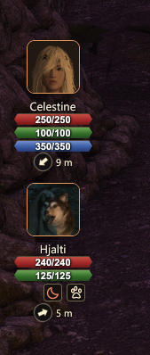

# PartyFrames Light

A small follower HUD for **Skyrim Special Edition and Anniversary Edition**, built with [Magelight UI](https://github.com/Severause/MagelightUI). Portraits, names and readable health, stamina and magicka bars, with just enough settings to put them where you want them.

**[Download the SE/AE release](https://github.com/Nosimo-SN/PartyFrames-Light/releases/latest)** · [Report a problem](https://github.com/Nosimo-SN/PartyFrames-Light/issues)

*SE/AE development screenshot. Portraits come from SeverActions; the dog magicka bar is replaced by Canine Drives indicators.*

## Features

- Shows actively following companions, including the vanilla follower slot and quest companions using standard follower state. SeverActions roster membership alone does not qualify.
- Reads existing SeverActions portraits and follows its selected portrait-frame/font theme. A monogram appears when no portrait is available.
- Move the party as a group or place individual cards. Change sizes, spacing, portrait visibility and numbers.
- Limit rows and columns; extra cards are omitted. Minions and summons are optional.
- Combat indicator, distance and a direction arrow relative to player facing. SeverActions survival icons appear only when needs reach debuff conditions.
- Keeps camp occupants visible while they use Sever's Hearth camping package.
- Optional Canine Drives integration replaces its tracked dog's magicka bar with hunger, tiredness and activity indicators. Uses the provider's warning flags and configured thresholds.
- Optional, off-by-default Hjalti overhead debugging through Status Indicator Framework.
- Hides the normal HUD while a Magelight menu owns UI focus.

One SKSE DLL, web assets and settings; **no ESP, ESL or Papyrus scripts**. No AI requests or portrait generation.

## Requirements

- Skyrim SE/AE with the matching [SKSE](https://skse.silverlock.org/).
- Address Library for SKSE Plugins for your game version.
- **Magelight UI 1.9.0 or newer**.
- Microsoft Visual C++ 2015–2022 x64 runtime.

Optional integrations:

| Mod | Adds |
| --- | --- |
| SeverActions, native API v2+ (4.8.0+) | Existing portraits; native follow state, theme and survival integration where available |
| Sever's Hearth | Recognition of its `Severs_CampingPackage` camp sandbox |
| Canine Drives 0.26.6+, API v1 | Tracked dog's authoritative need warnings and published activities |
| Status Indicator Framework – Floating Icons, API v1 | Optional overhead canine debugging icons; also requires Canine Drives |

Install optional mods separately. Ordinary follower frames work without those native APIs. Some custom quest companions expose no standard follower state and may need a compatibility rule; every quest and follower framework has not been tested.

**SE/AE only is offered here. VR is withheld pending a request and testing by someone with VR hardware.**

## Install and configure

1. Install the SE/AE ZIP through MO2 or your preferred mod manager. Start Skyrim through SKSE.
2. Press **Shift+F8** to open settings. Change the key and optional Shift/Ctrl/Alt modifiers there. Escape or Done closes settings; the game pauses while they are open.
3. Drag **Move party** to move the stack, or drag a follower card to place it separately. Select a follower for individual size and portrait controls.

Settings save automatically. Existing users keep their selected hotkey: updating does not reset it. If another mod manager file overrides the JSON, preserve the winning copy.

The public name is **PartyFrames Light**. Internal paths remain `SKSE/Plugins/PartyLight.dll`, `SKSE/Plugins/PartyLight.json`, `Magelight/PartyLight/` and `PartyLight.log` for compatibility with earlier local builds. Upgrade by replacing the earlier PartyLight mod; enable only one copy. Keep your existing JSON when prompted. Disable another party HUD if it produces duplicate frames.

## Canine indicators

Food and tiredness icons appear only when Canine Drives publishes their warning flags. The activity slot can show awake/unknown, eating, napping, hunting, sniffing, playing, fishing, scavenging, greeting, warming or fighting. Unknown future activities use a paw. When the API is unavailable, the ordinary magicka bar returns.

For overhead debugging, enable **Hjalti overhead debug icons** under **Dog debugging**. It defaults off, requires SIF and Canine Drives, and changes no dog behavior. Only its tracked dog receives these icons. The overhead integration still needs live-game confirmation.

## Testing and troubleshooting

The developer's SE/AE game has exercised portraits, active follower filtering, camp visibility, direction arrows, settings sliders and a live Canine Drives API snapshot. Version 0.4.2 is the public-name/packaging revision. Its DLL builds, all three native regression suites pass, and browser checks cover layout, controls, overflow, canine activities and warning visibility. These checks do not establish compatibility with every runtime, quest or mod combination. Overhead positioning and live toggling remain unverified.

If a frame is missing, confirm the actor is actively following or using the supported camp package. Waiting/home-rostered companions are intentionally excluded. Check row/column limits and the summons toggle. Another interior/worldspace displays **Elsewhere** because coordinates cannot be compared reliably.

For a bug report, include your Skyrim and SKSE versions, integration versions, steps to reproduce, and `Documents/My Games/Skyrim Special Edition/SKSE/PartyLight.log`. Avoid posting private data from unrelated logs.

## Build

See [BUILDING.md](docs/BUILDING.md). Source is GPL-3.0-or-later; third-party headers and libraries retain their own notices under `include/` and `package/SKSE/Plugins/PartyLight/Licenses/`.

Thanks to Severause for Magelight UI and SeverActions, the Canine Drives API work, CommonLibSSE-NG contributors, and Status Indicator Framework. Inspired by compact party sheets; no Skyrim Party Sheet code or assets are included.
